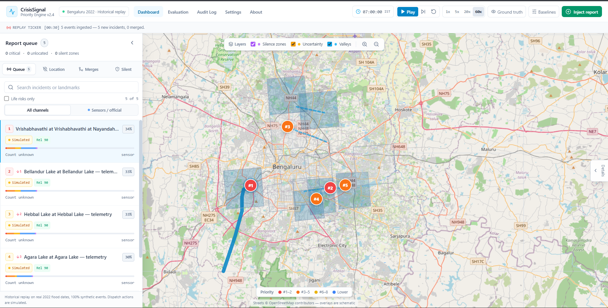
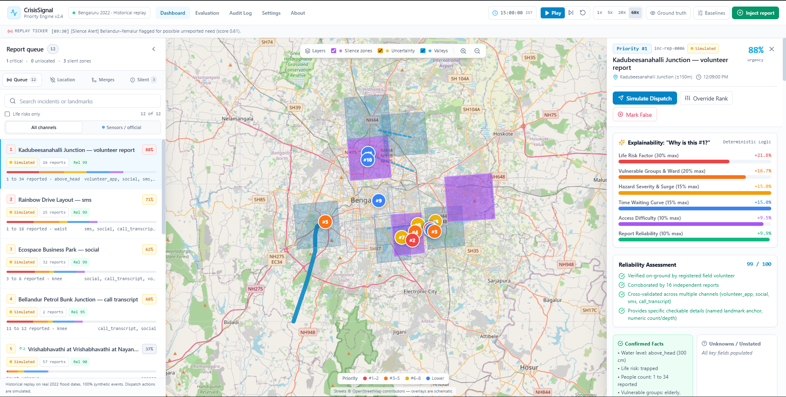
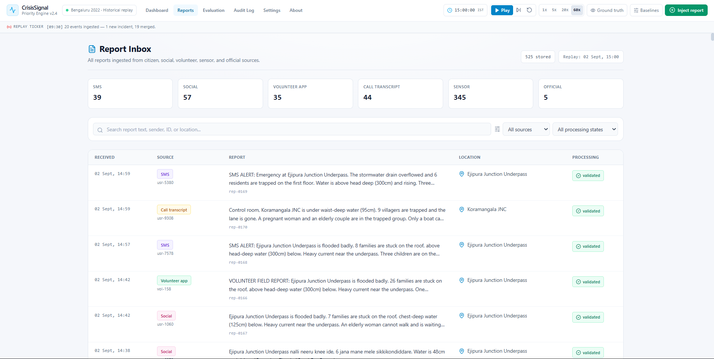
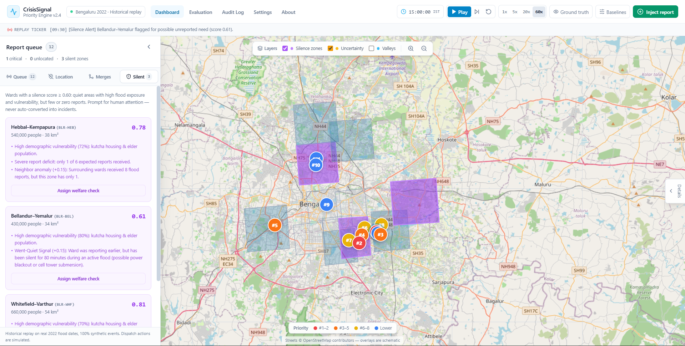

# CrisisSignal Priority Engine 🚨🌊

> **Emergency response decision-support for disaster control rooms**
>
> Turns messy, multi-channel flood reports into an explainable, ranked queue — and
> treats silence from a high-exposure zone as an urgent signal rather than an absence
> of need.

CrisisSignal is a **historical replay dated on the real Bengaluru flood window of
22 August – 8 September 2022** (IST). Actual rainfall, lake overflow dates and waterbody
geography are real; **every incident message, bulletin, telemetry reading and social post
is 100% synthetic**, generated offline by a seeded, deterministic generator. The app
reconstructs the information environment of a city control room — KSNDMC-style telemetry,
BBMP/KSNDMC/SDRF-style bulletins, citizen calls, SMS, volunteer reports and social
messages written in Kanglish and Hinglish. Events enter the console only at the timestamp
they would have become available, so the queue evolves the way a real control room would
have seen it.

> **Historical replay.** Real 2022 flood dates and Bengaluru geography, but 100%
> synthetic events. **Not live data.** Dispatch actions are simulated.

The app is fully offline. All replay data is pre-built JSON under `src/data/bengaluru/`;
there are no API keys, database calls, tile requests or live feeds at runtime.

---

## Prototype status

**Working prototype.** CrisisSignal is a functional offline simulation built with
synthetic Bengaluru flood data. The console, replay controls, incident analysis,
evaluation views, audit log, and coordinator workflows are implemented and tested.
It is not yet connected to live sensors, government feeds, emergency dispatch systems,
or a production database.

## UI screenshots

The following screenshots show the main user-facing parts of the prototype. The image
files live under [`docs/screenshots/`](C:/Users/HP/Desktop/college/srinivas-hackathon-demo/docs/screenshots/).

### Coordinator console

The main workspace combines the tactical map, incident queue, priority ranking, and
incident details.



### Incident details and “Why this rank?”

The detail panel shows extracted evidence, incident severity, reliability, urgency
factors, and recommended verification or action.



### Report inbox

The Reports page stores the normalized reports arriving from social, official,
sensor, volunteer, SMS, and call-transcript sources. Reports can be searched,
filtered by source and processing state, and opened to inspect their provenance.



### Silence Zone

The Silence Layer highlights exposed zones that may have an unreported need, including
connectivity gaps, coverage deficits, neighboring signals, and suggested welfare checks.



---

## Why this exists

Flood control rooms face two opposite failure modes:

1. **Loud, low-severity chatter** — well-connected areas generate hundreds of duplicate
   posts about ankle-deep water and dominate the queue.
2. **Silent, high-severity need** — a cut-off valley settlement loses power and mobile
   coverage, produces zero reports, and disappears from the picture precisely when it
   needs help most.

CrisisSignal addresses both with:

- **Explainable multi-factor ranking** with character-level evidence spans and a
  “Why this rank?” breakdown.
- **Duplicate consolidation with safety guardrails** that never merge an electrical
  hazard into routine waterlogging.
- **A Silence Layer** combining flood exposure, demographic vulnerability, connectivity
  gaps, report coverage deficits, neighbour signals and went-quiet signals.
- **A Fairness Boost** for low-connectivity, low-coverage incidents.
- **Human-in-the-loop controls** with a mandatory reason and an immutable audit log.

---

## Scenario and channels

| Item | Value |
| :--- | :--- |
| Replay window | 2022-08-22 00:00 IST → 2022-09-08 00:00 IST (events available 22 Aug – 7 Sep) |
| Geography | Bengaluru — Central (MG Road–Shivajinagar), Indiranagar–Domlur, Koramangala–Ejipura, Silk Board–HSR–BTM, Jayanagar–JP Nagar, RR Nagar–Vrishabhavathi Valley, Hebbal–Kempapura, Yelahanka–Kogilu, ORR IT Corridor (Bellandur–Kadubeesanahalli), Bellandur–Yemalur, Whitefield–Varthur, Thanisandra–Jakkur |
| Backbone true events | 10 (30 Aug – 5 Sep 2022) |
| Zones / landmarks | 12 / 60 |
| Total replay events | **767** |
| True silent zones | 2 (Yelahanka–Kogilu, Thanisandra–Jakkur) |

### Six input channels

| Channel | Count | Notes |
| :--- | ---: | :--- |
| Sensors (KSNDMC-style telemetry) | 450 | 5 gauging stations (Bellandur, Varthur weir, Hebbal, Vrishabhavathi at Nayandahalli, Agara) × 90 readings at 4-hour cadence from 2022-08-22; warning/danger thresholds and trend per station |
| Official bulletins (BBMP/KSNDMC/SDRF-style) | 9 | Control-room advisories, relief-camp and rescue-boat bulletins; one SDRF note on Yelahanka |
| Calls / transcripts | 84 | Generated citizen reports conditioned on backbone events |
| SMS | 64 | Short, typo-prone messages |
| Social | 94 reconstructed + 8 posts | Kanglish/Hinglish posts model rumour, recycled copy-paste and duplication |
| Field volunteers | 58 | On-ground observations from registered volunteers |

Citizen report volumes are fixed per backbone event (`hotspot_weights`, 300 reports
total) so the benchmark corpus is stable across rebuilds. Tone, water depth, access
status, hazards and people counts are conditioned on the underlying event: a relief-camp
bulletin does not produce “trapped on the roof” language.

### Provenance model

Every replay event — sensor, bulletin, call, SMS, social post and volunteer report — is
**synthetic** and stored with provenance `reconstructed`. Each item carries an amber
**Simulated** badge, and the sea-colored console copy never presents it as a real
recording. The queue has an **All Channels / Sensors & Official** filter for viewing just
the primary-source stream (telemetry and official bulletins).

### Replay semantics

- Every event is released at its **availability timestamp**, not the underlying event
  time. A bulletin published after a breach enters the queue at publication time.
- Arrivals with the same timestamp are processed as a group, so silence flags and
  lead-time measurements reflect the first threshold crossing rather than partial state.
- Sensor and official records fold into long-running incidents by stable keys
  (`sensor:<station>`, `official:<district>`) instead of creating a new incident per reading.
- Zone connectivity is time-varying. Thanisandra–Jakkur drops from 55% to 8% after the
  2022-09-04T05:00Z Jakkur culvert collapse severs fibre and tower power; Yelahanka–Kogilu
  runs on a thin 30% connectivity baseline.
- The generator rewrites each hotspot's chronologically last report with a curated
  closing update, so end-of-replay severity signals stay faithful to the hidden backbone
  without touching counts, channels or timestamps.
- Ground truth (`groundtruth.json`) is **hidden from the engine**. It is read only by the
  evaluator, after incidents have already formed and ranked.

---

## Run it

### Requirements

- Node.js 18+ and npm (the generator is plain Node ESM — no Python needed)

### Web app

```bash
npm install
npm run dev
```

Open <http://localhost:3000>. The console, map, evaluation page and audit log work with
no network connection.

```bash
npm run build   # production build
npm start       # serve the production build
npm test        # 20 deterministic engine/data tests
npm run audit   # headless full-replay verification (metrics below)
npm run data    # regenerate the synthetic replay data offline
```

The tactical map is a **schematic offline map**: a local graticule, zone polygons,
rivers (Vrishabhavathi, Koramangala–Challaghatta and Hebbal valleys) and labels drawn in
SVG/Leaflet with no tile server. Zoom is clamped to 9–17 so the schematic stays legible.

### Demo flow (2–3 minutes)

1. **Start on the console** and press **Play**, or use the **Jump to Case** buttons.
2. **Case (d) Ejipura underpass** — dozens of near-identical calls, SMS and social posts
   consolidate into one incident while independent locations remain separate.
3. **Case (e) live transformer** — a substation hazard beside routine waterlogging is
   kept as its own critical incident; the safety guardrail blocks the merge.
4. **Case (f) viral dam-release panic** — recycled copy-paste text claiming KRS gates
   opened without a siren is fingerprinted and does not inflate the reporter count.
5. **Case (b) Kogilu layout isolation** — low-connectivity reports receive a Fairness
   Boost and the zone is flagged for a welfare check.
6. **Case (a) loud ORR corridor** — the largest burst of shallow-water chatter does not
   outrank trapped/vulnerable reports.
7. **Case (c) Jakkur culvert collapse** — connectivity collapse re-scores the zone and
   the silence flag appears before the confirming bulletin.
8. Open **Evaluation** to see live metrics against baselines; open **Audit Log** to
   inspect every coordinator action with its reason.

The **Inject Report** button runs the deterministic extractor on new text and reshapes
the queue in real time. Example:

```text
Kogilu Cross road bridge washed away completely! 50 families cut off, water chest level
```

---

## Evaluation

The evaluation page recomputes every number from the current replay state. Nothing is
hardcoded or read from a stale metrics file. Current full-replay snapshot (all 767
events released; reproduce headlessly with `npm run audit`):

| Metric | CrisisSignal | FCFS | Loudest-Area-First |
| :--- | ---: | ---: | ---: |
| Top-5 priority overlap | **100%** | 60% | 60% |
| NDCG@10 | **1.00** | 0.57 | 0.53 |
| Kendall τ | **+0.78** | +0.24 | +0.20 |
| Kogilu equity incident rank | **#5** | #20 | #15 |

Other full-replay results:

- **Extraction:** 100% accuracy across location, life risk, water band, hazards and
  people count; 767/767 reports validated, “Unknown” scored as correct when the source
  says nothing.
- **Merging:** 20 citizen incidents formed for 10 true backbone events; precision 1.00,
  recall 1.00, F1 1.00. Cases (d), (e) and (f) pass; 13 recycled duplicates detected.
- **Silence:** 2/2 ground-truth silent zones detected (100% recall); mean lead time
  **+12.3 h**; 1/2 zones flagged early. Thanisandra–Jakkur is flagged **+24.6 h** before
  its first confirming report; Yelahanka–Kogilu is flagged within 7 minutes of its first
  report crossing. Exactly two zones are flagged in total (100% flag precision) and the
  district overlap with the official worst-hit list is 100%.
- **Equity story:** 4 low-connectivity incidents received a Fairness Boost. The Kogilu
  layout equity incident ranks **#5** under CrisisSignal versus **#15** under
  Loudest-Area-First.

### How the metrics are defined

- **Extraction accuracy** compares extracted location, life risk, water band, hazards and
  people count against cues in the source text and the hidden backbone event type.
- **Merge precision** is report-level weighted cluster purity: the share of reports in
  each formed incident that belong to its dominant true backbone group.
- **Merge recall** is macro group coverage: the mean fraction of each true group's
  reports covered by the incident that dominates that group.
- **Ranking metrics** use one representative incident per true group, ordered by the
  algorithm. Ground-truth ranks come from the curated backbone priority.
- **Silence lead time** = first-confirming-report time − first flag time. Positive means
  the zone was flagged before confirmation; negative means late. The mean includes
  negative values, and the page separately reports how many zones were early.

---

## Data pipeline

All pipeline code lives in `data-prep/` as standard-library-only Node ESM. It is fully
offline, deterministic (seed 42) and never scrapes. The scripts are ordered:

```bash
node data-prep/generate_all.mjs   # seeded synthesis → data-prep/final/*.json
node data-prep/build_events.mjs   # events.json + copy into src/data/bengaluru/
node data-prep/validate.mjs       # integrity checks; exits 1 on failure
```

`npm run data` runs all three. `validate.mjs` checks timestamp monotonicity,
provenance/channel integrity, scenario-window containment, Bengaluru coordinates,
gazetteer/zone geometry, ground-truth completeness, sensor threshold crossings and
cross-channel coverage.

Notes:

- The generator is a collection of pure functions — `generate_all` for the source
  datasets, `build_events` for the unified stream — with no network access, so the replay
  is byte-identical across rebuilds.
- `data-prep/validate.mjs` contains a forbidden-term guard (legacy scenario keywords)
  that intentionally lists the old terms; nothing else in the repository references them.
- The two silent-zone configurations (`zone-yelahanka` storm-drain overflow, `zone-north`
  culvert collapse) and all connectivity overrides are data, not code.
- The engine keeps an optional Gemini extraction path for ad-hoc experiments
  (`src/engine/extractor/index.ts`, `.env.example`). It is **off by default**
  (`use_gemini_api: false`) and the shipped replay never needs an API key.

### Data model

| File | Purpose |
| :--- | :--- |
| `events.json` | Unified, timestamp-sorted replay stream across all six channels (767 events) |
| `sensors.json` | 450 synthetic KSNDMC-style gauge readings and station metadata |
| `official.json` | 9 synthetic BBMP/KSNDMC/SDRF-style bulletins |
| `social.json` | 8 synthetic social posts with handles and engagement metadata |
| `reconstructed_reports.json` | 300 generated citizen reports with hidden backbone links |
| `zones.json` | 12 Bengaluru zones, polygons, demographics, connectivity overrides |
| `gazetteer.json` | 60 landmarks across the 12 zones with multilingual aliases |
| `groundtruth.json` | 10 true backbone events, 6 benchmark cases, worst-hit district table, 2 silent zones |

---

## Engine design

### Urgency score (0–1)

```text
Urgency = 0.30·LifeRisk + 0.20·Vulnerability + 0.15·Hazard
        + 0.15·TimeWaiting + 0.10·AccessDifficulty + 0.10·Reliability
        + FairnessBoost
```

| Factor | Behaviour |
| :--- | :--- |
| Life risk | Unconscious 1.0, medically dependent 0.95, trapped 0.85, injured 0.75; scaled by a log people-count curve (0.62–1.0 multiplier) |
| Vulnerability | Vulnerable groups blended with the zone’s demographic vulnerability index |
| Hazard | Water band, rising trend, electrical/current/collapse hazards |
| Time waiting | Saturating `1 − e^(−t/60)` curve |
| Access | Boat-only 0.95, road cut 0.85, blocked 0.55 |
| Reliability | Source type, independent corroboration, multi-channel agreement, specificity, location uncertainty |
| Fairness boost | `min(0.10, 0.10 × connectivity_gap × max(1 − coverage, 0.30))` when connectivity gap > 0.4 and either coverage deficit > 0.3 or the zone is flagged by the Silence Layer |

Severe life risk with low reliability is never buried; it is marked **VERIFY URGENTLY**
with a suggested verification step.

### Duplicate merging and guardrails

- Reports merge only when location, time window, and semantic/landmark evidence agree.
- Merge confidence ≥ 0.75 auto-merges; 0.55–0.75 becomes a suggested merge for human review.
- **Electrical guardrail:** a report mentioning an electrical hazard can never merge into
  an incident without one, or vice versa. This is exercised by real data: the Kempapura
  substation report and routine waterlogging on the same road are ~220 m apart and stay
  separate.
- **Life-risk escalation:** a more severe report escalates the incident instead of being
  split away and hidden.
- **Recycled-copy fingerprinting:** identical viral text does not increase the distinct
  reporter count or reliability score.

### Silence layer

```text
Silence = 0.30·Exposure + 0.25·Vulnerability + 0.20·ConnectivityGap
        + 0.25·CoverageDeficit + NeighbourSignal + WentQuietSignal
```

- Threshold ≥ 0.60 flags a zone as **Possible Unreported Need**.
- The score is **gated on a local flood signal** (reports, district incidents, or an
  active infrastructure outage). Static vulnerability alone cannot flag a zone on day 0.
- Dynamic connectivity overrides (for example, the Jakkur culvert collapse dropping
  Thanisandra–Jakkur to 8% connectivity) re-score zones as the replay progresses.
- A flagged zone never becomes an incident automatically. A coordinator assigns a
  volunteer callback, boat patrol or drone reconnaissance with a written reason.

---

## Human-in-the-loop and audit

Every coordinator action requires a reason:

- priority override,
- simulated dispatch,
- false-alarm dismissal,
- merge confirmation or incident split,
- manual location resolution,
- welfare-check assignment.

The audit page shows actor, timestamp, before/after state and reason for every action.
Dispatch is explicitly simulated; nothing leaves the browser.

---

## Repository layout

```text
src/
  app/                    Console, evaluation, audit, settings, about pages
  components/             Simulation bar, queue, detail panel, lanes, map, overlays
  data/bengaluru/         Pre-built offline replay JSON + typed loaders
  data/landmarks.ts       Bengaluru landmark list used by the console
  data/city.ts            Bengaluru city configuration (center, bounds, zoom)
  data/groundTruth.ts     Hidden backbone groups, silent zones, benchmark cases
  data/scenarios/         Bengaluru 2022 scenario metadata and key moments
  engine/
    extractor/            Deterministic multilingual field extraction
    location/             Gazetteer resolution with district-centroid fallback
    merger/               Spatial/temporal/semantic merge + safety guardrails
    scoring/              Urgency, reliability and silence scoring
    simulation/           Replay baselines and ground-truth evaluator
  store/                  In-memory replay engine and coordinator state
data-prep/                Node ESM generator, build and validation pipeline
scripts/tests.ts          Deterministic engine + data integrity tests
scripts/replay-audit.ts   Headless full-replay audit used for the metrics above
```

---

## Limitations and safety

- **Historical replay, not live validation.** The benchmark proves the logic and equity
  behaviour against a known backbone over real 2022 flood dates; it does not claim
  operational accuracy in an ongoing disaster.
- **Every event is synthetic.** Sensors, bulletins, calls, SMS, volunteer reports and
  social posts are generated offline. They preserve event timing and severity, but they
  are not recordings of real people or real telemetry.
- **Modelled demographics and connectivity.** Zone populations, vulnerability indices
  and connectivity levels are estimates for the replay, not authoritative operational
  data.
- **Flood scope only.** The extractor and scoring model are tuned for urban flooding,
  lake breaches, culvert/bridge failures and waterlogging.
- **Decision support only.** Coordinators retain final authority. The system is not a
  certified emergency dispatch/CAD platform.
- **Weights require calibration.** Defaults are sensible starting points and should be
  tuned with local disaster-management authorities (BBMP, KSNDMC, SDRF/NDRF).
- **Map is schematic.** It is an offline orientation aid, not a survey-grade basemap.

---

## Footer disclaimer

The console footer displays:

> Historical replay on real 2022 flood dates with 100% synthetic events. Not live data.
> Dispatch actions are simulated.

---

## Testing

```bash
npm test
npm run audit
```

The suite covers data integrity and channels, Kanglish/Hinglish extraction, location
resolution and district fallback, merge safety guardrails, reliability and fairness, and
silence calibration (including day-zero false-positive prevention and the Jakkur culvert
override). Current result: **20 passed, 0 failed**. The audit runs the exact same replay
pipeline headlessly over the full window and prints the metrics snapshot above.
